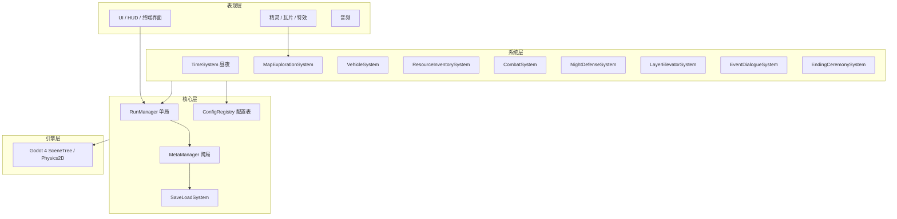
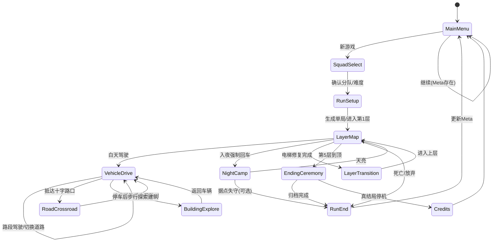

# 《终末旅行》技术设计说明书 

> 对应课程文档：**技术设计说明书**  
> 设计输入：《游戏开发建议书》《终末旅行 — 游戏概念设计文档》  
> 文档状态：**草稿 v0.2**（已随原型迭代更新，对应已实现 3 层原型）

## 一、文档目的与范围

### 1.1 摘要

本文档将《游戏开发建议书》中的玩法与系统设计 **翻译为可实现的工程方案**，供开发阶段直接参照，包括：

- 技术选型与架构
- 模块划分与接口
- 核心数据结构与关键流程
- 存档、UI、资源管线
- 技术风险与备选方案

### 1.2 实现范围


| 阶段           | 范围                                                                    |
| ------------ | --------------------------------------------------------------------- |
| **MVP（必须）**  | 2～3 层可玩；车辆移动与燃料；基础资源与电梯修复；**实时俯视角塔防**（7 种设施、波次敌人、能源调度）；单局/跨局存档隔离；基础文本叙事；到顶归档 + 勘探日记上传 |
| **完整版（充裕时）** | 三层完整；≥2 分队；智能机器 NPC 交涉；跨局档案 Meta + 顶层三选一；层间视觉差异                       |
| **暂不实现**     | 联机、Steam 成就、Mod、完整手柄适配、多语言（可预留接口）                                     |


### 1.3 术语


| 术语        | 含义                    |
| --------- | --------------------- |
| **Run**   | 单局游戏，从克隆人投送到死亡/到顶/放弃  |
| **Meta**  | 跨局持久数据（勘探日记上传、遭遇解锁项） |
| **Layer** | 城市层级，1～3（原型实现 3 层）    |
| **归档仪式**  | 到顶后的结算演出：真相片段、勘探日记、程序播报 |


---

## 二、技术选型

### 2.1 结论


| 角色      | 选择                                     |
| ------- | -------------------------------------- |
| **主方案** | **Godot 4.x + GDScript**               |
| **备选**  | Python 3 + Arcade（若第 1 周 Spike 未通过则切换） |


**推荐 Godot 的理由**（与建议书一致）：

- 原生 2D 场景树、TileMap、碰撞、UI、状态机，覆盖本作全部底层需求
- 场景/资源编辑器减少纯代码搭建关卡的成本
- `Resource` / `JSON` 配置表适合事件池、分队、敌人数据驱动
- 轻量、无授权费，适合课程与独立项目

**Arcade 回退条件**（触发任一即评估切换）：

- 7 天内无法完成：可移动车辆 + 简单地图 + 一次昼夜切换
- TileMap/碰撞工作量超出 2 人产能且无法砍 scope

### 2.2 技术栈总表


| 类别    | 选型                                       |
| ----- | ---------------------------------------- |
| 引擎    | Godot 4.3+（LTS 稳定版优先）                    |
| 语言    | GDScript                                 |
| 版本控制  | Git + GitHub                             |
| 数据配置  | Godot Resource (`.tres`) + JSON（Meta 存档） |
| 存档    | `user://meta.json`（跨局）；单局原则上不持久化         |
| 图像    | PNG/WebP；TextureAtlas / TileSet          |
| 音频    | OGG；AudioStreamPlayer2D + BGM bus        |
| 文本    | CSV 或 JSON 外挂（中英可后加）                     |
| AI 美术 | 统一 Prompt 模板 → 人工裁剪/调色 → 导入 `assets/`    |
| 辅助开发  | Coding Agent（生成脚本草稿、工具脚本）                |


### 2.3 第三方依赖

- 尽量 **零第三方插件** 完成 MVP
- 若对话量大，可评估 **Dialogue Manager** 等 Godot 插件；MVP 阶段用自研轻量 `EventDialogueSystem` 即可

---

## 三、系统架构

### 3.1 分层架构




### 3.2 场景流转




**主场景**：


| 场景                     | 职责                                    |
| ---------------------- | ------------------------------------- |
| `main_menu.tscn`       | 新游戏、继续、设置、档案/留言墙浏览                    |
| `squad_select.tscn`    | 分队、难度                                 |
| `layer_world.tscn`     | 单层探索主场景（子节点：道路驾驶、步行探索、交互点、缩略图、路口切换）   |
| `night_camp.tscn`      | 夜晚布防 UI + 简化据点视图（或与 layer 同场景切 State） |
| `ending_ceremony.tscn` | 归档仪式、顶层三选一                            |
| `credits.tscn`         | 真结局人员名单                               |


### 3.3 单局与跨局隔离（核心原则）

```
┌─────────────────────────────────────────┐
│  MetaManager (Singleton, 持久)           │
│  - archives[1..5]: bool                 │
│  - message_wall: Array[MessageEntry]    │
│  - unlocked_squads, endings_seen        │
└─────────────────┬───────────────────────┘
                  │ 只读暴露给 Run
                  ▼
┌─────────────────────────────────────────┐
│  RunManager (每局 new / clear)           │
│  - run_state: RunState                  │
│  - 死亡/结束时 discard                   │
│  - 仅向 Meta 提交：档案片段、留言、结局标志  │
└─────────────────────────────────────────┘
```

**硬性规则**：

- `RunState` **永不**整包写入 Meta 存档
- Meta 写入只在 **RunEnd**、**EndingCeremony** 的明确 `commit()` 点发生
- 开发模式可提供「单局调试快照」，默认关闭

---

## 四、玩法—技术映射


| 设计（建议书） | 技术实现要点                                                                   |
| ------- | ------------------------------------------------------------------------ |
| 白天探索拆分  | `VehicleDriveState` 与 `OnFootExploreState` 分离；车只在道路上移动，步行阶段进入建筑物收集资源      |
| 路口转向    | `RoadCrossroadState` 统一采用上北下南的坐标与缩略图方向；驶入指定路段一定距离后锁定路线              |
| 地图展示    | 主画面显示当前区域窗口，右下角显示全局缩略图；已探索区域高亮，未探索区域置黑，玩家位置实时标记          |
| 随机地图    | `MapGenerator` 按层种子直接生成区域图与资源点；每次进入新区域重新生成，避免先手工再导图            |
| 车载移动    | `VehicleSystem` 控制 RigidBody2D/CharacterBody2D；燃料随移动距离或时间扣减              |
| 夜晚回车停泊  | `TimeSystem` 达到 `day_length` 强制 `enter_night()`；未在安全区则惩罚                 |
| 电梯修复    | `LayerElevatorSystem` 读取 `LayerConfig.repair_cost`，消耗 `Inventory` 进度条满解锁 |
| 资源稀缺    | `ResourceInventorySystem` 堆叠上限 + 车厢容量；夜晚车外储物风险                           |
| 战斗      | `CombatSystem`：遭遇触发 → 即时或简化回合；弹药 Consumable                              |
| 夜晚布防    | `NightDefenseSystem`：实时俯视角塔防；布防阶段放置设施 → 战斗阶段抵御波次敌人；结算按车辆 HP 与突破数扣资源/耐久，非一次性判定成败 |
| 机器 NPC  | `EventDialogueSystem` + `NPCInstanceState` 条件表                           |
| 档案 Meta | 到达层 + `EventFlags` 触发 → `MetaManager.unlock_archive(layer)`              |
| 勘探日记上传 | 归档时 `JournalEntry{ title, body, layer, timestamp, run_id }` 追加 JSON     |
| 三选一终局   | `archives.all_unlocked` && 第 3 层控制室 → `EndingCeremonySystem` 分支          |


---

## 五、模块划分

### 5.1 模块清单


| 模块                        | 类型              | 职责                   |
| ------------------------- | --------------- | -------------------- |
| `GameManager`             | Autoload        | 全局暂停、场景切换、调试命令       |
| `RunManager`              | Autoload / 或场景根 | 持有 `RunState`，局开始/结束 |
| `MetaManager`             | Autoload        | 持有 `MetaState`，读写存档、档案/证据/权限  |
| `SaveLoadSystem`          | Autoload        | JSON 序列化、版本迁移        |
| `ConfigRegistry`          | Autoload        | 加载 `.tres` / JSON 配置 |
| `EvidenceData`            | Autoload        | 加载档案定义 JSON，提供查询接口  |
| `TimeSystem`              | Node            | 昼夜计时、阶段切换事件          |
| `MapGenerator`            | Node            | 层地图生成、区域重建、资源点/路口布局 |
| `MapExplorationSystem`    | Node            | 驾驶/步行切换、交互点、迷雾(可选)   |
| `VehicleSystem`           | Node            | 移动、燃料、车辆耐久、储物挂载      |
| `ResourceInventorySystem` | Node            | 物品增删、合成(可选)、车厢内外区分   |
| `CombatSystem`            | Node            | 遭遇、伤害、弹药             |
| `NightDefenseSystem`      | Node            | 夜晚塔防入口：启动/结束 `NightTdController` 会话，转发结算结果 |
| `LayerElevatorSystem`     | Node            | 层索引、电梯修复、层切换         |
| `EventDialogueSystem`     | Node            | 静态事件、机器人 NPC 对话树/条件表 |
| `CommunicationTerminal`   | Node / Scene    | 通信终端 UI 与流程、证据验证、权限移交 |
| `EndingCeremonySystem`    | Node            | 归档 UI、终局三选一          |
| `UIManager`               | CanvasLayer     | HUD、弹窗、背包、档案库显示     |
| `AudioManager`            | Autoload        | BGM/SE _bus          |


### 5.2 建议目录结构（Godot）

```
res://
├── autoload/          # GameManager, MetaManager, SaveLoad, Audio, Config
├── scenes/
│   ├── menu/
│   ├── world/
│   ├── ui/
│   └── ceremony/
├── scripts/
│   ├── core/          # run_state.gd, meta_state.gd
│   ├── systems/       # 各 System
│   └── data/          # 配置类脚本
├── resources/         # .tres 分队、敌人、事件
├── data/json/         # meta 模板、事件表（可选）
├── assets/
│   ├── tiles/
│   ├── sprites/
│   ├── audio/
│   └── fonts/
└── tests/             # 可选：GUT 单元测试
```

### 5.3 模块依赖（简化）

- `LayerWorld` 依赖：`RunManager`, `TimeSystem`, `MapExploration`, `Vehicle`, `UI`
- `NightCamp` 依赖：`NightDefense`, `ResourceInventory`, `Vehicle`
- `EventDialogue` 依赖：`ConfigRegistry`, `RunState`（写 flags）, `MetaManager`（档案解锁）
- `EndingCeremony` 依赖：`MetaManager`, `SaveLoad`

---

## 六、核心数据结构

### 6.1 RunState（单局）

```gdscript
# 逻辑结构示意（GDScript class 或 Dictionary）
class_name RunState

var run_id: String                 # UUID
var squad_id: String
var difficulty: int
var seed: int
var current_layer: int             # 1-5
var day_index: int                 # 本层第几天

var exploration_mode: String       # "drive" | "crossroad" | "walk"
var area_seed: int                 # 当前区域随机种子
var current_area_id: String        # 当前道路/建筑区域 id
var time_phase: String             # "day" | "night"
var player_hp: float
var vehicle: VehicleState
var inventory: InventoryState
var elevator: ElevatorState        # 当前层修复进度
var event_flags: Dictionary        #  string -> bool/int
var npc_states: Dictionary         #  npc_id -> NPCInstanceState
var archives_found_this_run: Array[int]  # 本局已触发片段的层
```

### 6.2 MetaState（跨局）

```gdscript
class_name MetaState

const SAVE_VERSION := 1

var archives_unlocked: Array[bool]       # 长度 5，索引 0 = 第1层
var message_wall: Array                  # MessageEntry
var endings_seen: Array[String]          # "shutdown" | "loop" | "fake_success"
var unlocked_squad_ids: Array[String]
var evidence_collected: Array[String]    # evidence_id 列表（跨局累积）
var total_runs: int

# 关键阈值
const EVIDENCE_THRESHOLD_FOR_TRANSFER := 3  # 可配置，证据数足够后触发权限移交
```

### 6.3 VehicleState / InventoryState

```gdscript
class_name VehicleState
var fuel: float
var fuel_max: float
var durability: float
var position: Vector2
var facing_dir: Vector2             # 道路驾驶时的朝向
var upgrades: Dictionary           # slot -> upgrade_id

class_name InventoryState
var items: Dictionary                # item_id -> count
var cargo_inside: Dictionary         # 车内
var cargo_outside: Dictionary        # 车外（夜晚风险）
```

### 6.4 NightDefense（实时塔防子系统）

夜晚进入独立塔防场景 `night_td_standalone.tscn`，由 `NightTdRoot` 驱动。实际逻辑集中在 `NightTdController` 中，分三阶段运行：放置（PLACE）→ 战斗（COMBAT）→ 结算（RESULT）。

**核心脚本**（`game/scripts/night_td/`）：

| 脚本 | 职责 |
|------|------|
| `night_td_root.gd` | 场景根节点：从 `GameManager` 读取 `RunState`，启动 `NightTdController`，接收结算后切回白天 |
| `night_td_controller.gd` | 核心控制器：阶段切换、敌人刷新、塔攻击、寻路、结算 |
| `night_td_field.gd` | 场地渲染：网格、车辆、塔、敌人、投射物、热力图、框选交互 |
| `night_td_defs.gd` | 静态数据：加载 `tower_defs.json` / `enemy_defs.json`，提供查询接口 |
| `night_td_wave_scheduler.gd` | 波次调度：按时间触发刷怪，支持 `NightTdWavePlan` 配置 |
| `night_td_wave_design.gd` | 波次计划：解析 JSON 中的路线（routes）、出生点（spawn_points）、波次（waves） |
| `night_td_flowfield.gd` | 流场寻路：带权 Dijkstra 积分场，O(1) 采样梯度方向 |
| `night_td_influence.gd` | 威胁影响图：将塔的火力铺成网格标量场，供流场叠加额外代价 |
| `night_td_commander.gd` | 指挥官 AI：敌人分组、集结、佯攻、攻坚塔/基地；牧羊者被击杀/策反后退化 |
| `night_td_energy.gd` | 能源系统：反应堆产能 + 电池；耗电塔可调功率档，超载时 brownout |
| `night_td_hacking.gd` | 黑入系统：纯逻辑（进度推进、策反判定、友军拦截目标选择） |
| `night_td_hud.gd` | 塔防 HUD：阶段提示、资源、事件日志、功率面板、塔卡片、结算面板 |

**结算输出**（`NightTdController._build_result()` 返回的 Dictionary）：

```gdscript
{
    "outcome": "success" | "partial" | "fail" | "vehicle_destroyed",
    "message": String,                    # 文本描述
    "base_hp": float,                     # 车辆剩余 HP
    "base_hp_max": float,
    "enemies_killed": int,
    "enemies_reached": int,               # 突破数
    "inventory_loss": int,                # 旧 deploy-point 模式的抽象损失（backpack 模式时为 0）
    "breach_losses": Dictionary,          # item_id -> count，实时突破拖走的物资明细
    "breach_total": int,
    "salvage": Dictionary,                # 夜末回收物资（幸存塔退还 + 击毁废料 + 策反零件）
    "tower_refund": Dictionary,           # 按塔类型统计的幸存/损毁明细
    "kill_log": Array[Dictionary],        # 击杀记录（type, scrap）
    "converted_survivors": Array,         # 策反存活到夜末的敌人（type, parts_value）
    "final_backpack_dict": Dictionary,    # 夜末背包快照（含建造消耗、突破损失、回收）
    "resources_spent": int,
    "defense_power": int,                 # 用于评分/难度自适应
    "threat_power": int,
    "fuel_loss": float,                   # 车辆严重受损时的额外燃料损失
}
```

### 6.5 配置表（Data-Driven）


| 资源类型          | 文件示例                    | 字段要点                                      |
| ------------- | ----------------------- | ----------------------------------------- |
| `SquadDef`    | `squad_scavenger.tres`  | `id`, `modifiers`                         |
| `LayerConfig` | `layer_01.tres`         | `repair_cost`, `map_pool`, `threat_table` |
| `EnemyDef`    | `enemy_defs.json`       | `hp`, `speed`, `base_damage`, `armor`, `hack_resist`, `is_shepherd` |
| `EventDef`    | `event_terminal_a.tres` | `conditions`, `choices[]`, `effects`      |
| `TowerDef`    | `tower_defs.json`       | `name`, `cost`, `range`, `damage`, `hp`, `build_cost`, `salvage`, `upkeep`, `power_curve` |
| `ArchiveDef`  | `archive_layer_03.tres` | `layer`, `unlock_flag`, `text_id`         |


---

## 七、关键算法与流程

### 7.1 昼夜状态机

```
[DAY] --(timer >= day_length OR player_rest)--> [NIGHT_SETUP]
[NIGHT_SETUP] --(player_confirm_defense)--> [NIGHT_RESOLVE]
[NIGHT_RESOLVE] --(apply_result)--> [DAY] (+day_index)
```

- 入夜：**强制** 车辆进入 `CampZone`；否则 `%` 额外耐久损失
- `TimeSystem` 发出信号：`day_started`, `night_started`, `night_resolved`

### 7.2 燃料消耗（推荐 MVP 方案）

```
move_cost = distance_delta * fuel_rate * squad_modifier * terrain_modifier
```

- 燃料为 0：车辆无法移动，玩家步行范围受限（可选）或只能搜附近

### 7.3 地图生成（MVP → 完整）


| 阶段  | 算法                                                            |
| --- | ------------------------------------------------------------- |
| MVP | 每层按 `LayerConfig.seed` 直接生成可走道路、十字路口、建筑点与资源点；以区域图替代手工整层图 |
| 完整  | `seed` + **房间图**：预制 `RoomChunk` 按规则拼接；保证电梯、营地、至少 1 档案点可达      |

- 地图以“当前区域窗口 + 全局缩略图”双层呈现，主画面只渲染附近可见范围
- `MapGenerator` 在进入新区域时重建当前区域内容，并同时更新缩略图探索状态
- 十字路口使用统一朝向表达，避免驾驶视角与缩略图方向混乱


### 7.4 夜晚塔防战斗与结算

**流程**：
```
[DAY] --(timer >= day_length)--> [NIGHT_TD_SCENE]
[NIGHT_TD_SCENE] --(session_finished)--> [apply_result] --> [DAY] (+day_index)
```

**阶段**：
1. **PLACE（布防，180s）**：玩家在俯视网格上放置设施（左键放置、右键撤销、全额退款）。显示流场方向箭头（可选）与火力热力图。可提前按「开始接敌」跳过等待。
2. **COMBAT（战斗）**：按波次计划实时刷怪。敌人沿流场涌向车辆，塔自动攻击，路障阻挡并可被敌人近战摧毁。玩家可：
   - 点选入侵天线（hacker）再点敌人，指派策反目标
   - 在功率面板调节耗电塔的功率档（0~2 档），或框选多塔批量调节
   - 切换热力图覆盖层查看火力密度
3. **RESULT（结算）**：波次清空或车辆 HP 归零后弹出结算面板。

**核心机制**：
- **流场寻路**：每格代价 = 1.0 + 路障软绕行代价 + 危险权重 × 火力威胁。难度 0 无视火力，难度 2 主动绕开杀伤区。
- **指挥官 AI**：敌人受牧羊者（shepherd）指挥，分组集结后攻坚塔或佯攻基地。牧羊者被击杀/策反后指挥链中断 8 秒，敌群退化为各自冲锋。
- **能源系统**：反应堆持续产能 + 电池储能。耗电塔可调功率（影响伤害/射速/黑入速率），超载时 brownout 按比例降效。
- **策反（黑入）**：入侵天线引导进度达标后敌方单位倒戈为友军，自动拦截最近的敌人；无敌可拦时退回基地附近。
- **突破损失**：敌人抵达车辆时从背包拖走物资（优先废料/木材，其次燃料/补给，最后零件），同时车辆承受轻微伤害。车辆 HP 归零则本局结束。
- **夜末回收**：幸存塔全额退还 `build_cost`，被毁塔产出 `salvage`；击毁敌人掉落废料；策反存活敌人产出零件。

**数据来源**：
- `game/data/night_td/tower_defs.json` — 塔属性与建造/回收成本
- `game/data/night_td/enemy_defs.json` — 敌人属性
- `game/data/night_td/energy.json` — 反应堆参数与难度危险权重
- `game/data/night_td/waves/night_wave_*.json` — 波次计划（按 day/diff 动态选择）

> **注**：`cargo_inside` / `cargo_outside` 区分、环境恶化（B）、`shelter_upgrade` 在 MVP 中暂未实现，背包统一为一份快照传入塔防场景。

### 7.5 档案解锁

```gdscript
func try_unlock_archive(layer: int, flag: String) -> void:
    if not ConfigRegistry.archive_requires(layer, flag):
        return
    if RunManager.run_state.event_flags.get(flag, false):
        MetaManager.unlock_archive(layer)  # 持久化
```

- **不必到第 3 层**：只要本局到达该层并满足 `ArchiveDef` 条件即 `commit` 到 Meta

### 7.6 顶层终局（分两阶段）

**第一次到顶（首次通关）**：
```gdscript
func on_reaching_layer_3_control_room() -> void:
    # 进入通信终端流程
    communication_terminal.show_initial_flow()
    # → 汇报和判断 + 身份识别CAPTCHA + 被击毙
    communication_terminal.show_strike_message()
    # 克隆人死亡，但所有勘探日记自动上传至 MetaManager
```

**集齐足够证据后的顶层流程**：
```gdscript
func can_unlock_management_transfer() -> bool:
    return MetaManager.encounters_unlocked_count() >= MetaManager.required_encounter_count()

func on_reaching_layer_3_with_evidence() -> void:
    if can_unlock_management_transfer():
        communication_terminal.show_evidence_verification_flow()
        # → 系统识别"人类指挥部已不存在"
        # → 宣布权限移交给克隆人
        MetaManager.management_rights_transferred = true
        show_final_choice_modal()
    else:
        on_reaching_layer_3_control_room()  # 重复首次流程

func show_final_choice_modal() -> void:
    match final_choice:
        "shutdown": 
            MetaManager.endings_seen.append("shutdown")
            show_credits()  # 真结局
        "loop": 
            MetaManager.endings_seen.append("loop")
            append_message_to_wall()
            run_end()
        "fake_success": 
            MetaManager.endings_seen.append("fake_success")
            run_end()
    SaveLoadSystem.save_meta()
```

### 7.7 通信终端系统（CommunicationTerminalSystem）

**流程图**：
```
┌─────────────────────────────────────┐
│ 首次到顶：通信终端                    │
├─────────────────────────────────────┤
│  1. 文本显示（自动）                   │
│     "您的观察报告已接收..."            │
│  2. 汇报选择（虚拟，不影响后续）       │
│     - "地表宜居" / "地表不宜"          │
│  3. 身份识别 CAPTCHA（虚拟）           │
│     - 拖动滑块                       │
│  4. 验证结果（始终失败）              │
│     "未识别到人类"                   │
│  5. 击毙消息                         │
│     "感谢您的付出。[被击毙]"          │
└──────────────────┬──────────────────┘
                   │ 克隆人死亡
                   ▼
         本轮档案存储到 Meta
         
┌─────────────────────────────────────┐
│ 集齐证据后到顶：权限移交终端           │
├─────────────────────────────────────┤
│  1. 同上 1～3 阶段（流程相同）        │
│  2. 识别成功（证据足够）              │
│     "证据验证通过"                   │
│  3. 权限移交                         │
│     "最高权限已移交至..."             │
│  4. 进入最终三选一                    │
└─────────────────────────────────────┘
```

**数据结构**：
```gdscript
class_name CommunicationTerminalState
var phase: String                      # "display" | "report_choice" | "captcha" | "result" | "permissions_transfer"
var choice_made: String                # 汇报选择（"habitable" | "uninhabitable"）
var evidence_for_verification: Array[String]  # 玩家选择展示的证据 ID 列表
var is_evidence_sufficient: bool       # 根据数量判定

class_name TerminalMessage
var speaker: String                    # "system" | "clone"
var text: String
var text_id: String                    # 本地化用 key
var auto_advance_after_sec: float      # 0.0 = 等待用户点击
```

**集成点**：
- `main.gd` 第 3 层逻辑：检测 `MetaManager.has_all_truth_encounters()`，决定展示哪种流程
- 终端 UI Scene：`communication_terminal.tscn`，含文本框、背包快捷、结果展示
- 事件标志：`on_communication_terminal_ended` 信号触发后续 `RunEnd` 或 `FinalChoice` 逻辑

### 7.8 勘探日记系统（JournalData）

> 注：本节替代早期设计中的「证据收集系统（EvidenceSystem）」与「背包档案库」概念。实际实现以**勘探日记**为核心——与智能 NPC 完成剧情交互后自动写入日记，到顶时上传至昆仑终端，跨局可阅读前代日志。集齐全部关键遭遇情报后解锁三选一终局。

**日记条目定义**（`journal_encounters.json`）：
```json
{
  "required_stories_for_truth": ["furnace_qc", "chronicler_04", "staff_officer_07", "marian_k142"],
  "required_for_truth": ["furnace_truth", "chronicler_repair", "staff_officer_07_calibrate", "marian_obey"],
  "encounters": [
    {
      "encounter_id": "sentinel_s09_parts_gave2",
      "npc_id": "sentinel_s09",
      "title": "10032军营 · 哨兵 S-09",
      "journal_body": "..."
    }
  ]
}
```

**写入机制**：`StoryController` 在 NPC 对话分支结束后，根据 `choice_id` 调用 `JournalData` 查询对应 `encounter_id`，追加到本局 `RunJournal`。同一 NPC 不同抉择产生不同日记篇目。

**上传与跨局**：到顶时 `MetaManager.upload_run_journal()` 将本局日记写入 `user://meta.json`；终端 UI 展示前代上传记录与当前局日记合并视图。`encounters_unlocked` 数组记录跨局已解锁的遭遇 ID，用于判定「真相拼合」条件。

---

## 八、持久化与存档

### 8.1 文件


| 文件                          | 内容             |
| --------------------------- | -------------- |
| `user://meta.json`          | `MetaState` 全量 |
| `user://settings.cfg`       | 音量、键位、窗口       |
| （可选）`user://debug_run.json` | 开发用单局快照        |


### 8.2 JSON 示例（片段）

```json
{
  "save_version": 1,
  "encounters_unlocked": ["furnace_truth", "chronicler_repair"],
  "journal_uploads": [
    {
      "run_id": "1718000000",
      "layer": 3,
      "day_index": 5,
      "reached_top": true,
      "entries": [
        {
          "encounter_id": "furnace_truth",
          "title": "弹药库 · 熔炉",
          "body": "...",
          "layer": 1,
          "day_index": 2
        }
      ]
    }
  ],
  "endings_seen": [],
  "unlocked_squad_ids": ["scavenger", "logistics"],
  "management_rights_transferred": false,
  "total_runs": 7
}
```

> **注**：`game/data/evidence.json` 与背包「档案库」标签页在早期设计中被废弃，以 `journal_encounters.json` + 勘探日记上传系统替代。详见 §7.8。

### 8.3 版本迁移

- `save_version` 不匹配时：尝试字段级迁移；失败则备份旧文件并新建 Meta（开发期可接受；发布前需完善）
- 旧存档不含 `evidence_collected` 时：初始化为空数组 `[]`
- 旧存档不含 `management_rights_transferred` 时：初始化为 `false`

---

## 九、用户界面与输入

### 9.1 UI 分层


| 层级       | 内容                                        |
| -------- | ----------------------------------------- |
| HUD      | 燃料、生命、时间（昼/夜）、层数、快捷栏、当前探索模式 |
| MiniMap  | 右下角全局缩略图：已探索高亮、未探索黑块、玩家位置标记、路口方向提示 |
| Terminal | 昆仑风面板：背包、车辆、电梯修复、**档案库** |
| Overlay  | 对话、事件选项、布防放置、**通信终端** |
| Modal    | 暂停、确认、归档、**权限移交确认**、三选一 |


### 9.2 默认键位（草案）


| 操作     | 键位         |
| ------ | ---------- |
| 移动     | WASD / 方向键 |
| 交互     | E          |
| 开火     | 鼠标左键 / J   |
| 背包     | Tab        |
| 入夜开始接敌 | Space      |
| 暂停     | Esc        |


### 9.3 对话 UI

- MVP：`EventDialogueSystem` 显示 **说话者 ID + 文本 + 2～4 选项按钮**
- 机器 NPC：说话者显示为 `档案管理机 #07` 等，头像复用同一套机器人 Silhouette

### 9.4 通信终端 UI（CommunicationTerminal.tscn）

**首次到顶流程（非交互式展示）**：
```
┌──────────────────────────────────┐
│  通信终端                        │
├──────────────────────────────────┤
│                                  │
│  【系统】                        │
│  您的观察报告已接收。请评估地表 │
│  宜居性：                        │
│                                  │
│  [地表宜居] [地表不宜]           │
│                                  │
│                   [继续]          │
└──────────────────────────────────┘
     ↓ (选择无实质影响，自动进入下一步)
     
┌──────────────────────────────────┐
│  身份识别验证                    │
├──────────────────────────────────┤
│                                  │
│  请完成验证：                    │
│  [████████░░] 拖动以补全        │
│                                  │
│            [提交]                │
└──────────────────────────────────┘
     ↓ (无论如何提交都判定失败)
     
┌──────────────────────────────────┐
│  【系统】                        │
│  未识别到人类。                  │
│  感谢您的付出。                  │
│                                  │
│  [  被  击  毙  ]                │
└──────────────────────────────────┘
```

**集齐证据后的权限移交流程**：
```
┌──────────────────────────────────┐
│  通信终端                        │
├──────────────────────────────────┤
│ （前两步同上）                  │
│                                  │
│ ⚠ 【系统】                       │
│  证据验证通过。                  │
│  指挥部已确认失联。              │
│  管理权限现转移至:               │
│  > [克隆人 007]                  │
│                                  │
│            [确认]                │
└──────────────────────────────────┘
     ↓
┌──────────────────────────────────┐
│  最终选择                        │
├──────────────────────────────────┤
│                                  │
│  您现拥有昆仑计划最高决策权。    │
│  请选择:                         │
│                                  │
│  [ 停机昆仑 ] 克隆纪元开始       │
│  [ 继续循环 ] 接纳克隆命运       │
│  [ 欺骗程序 ] 保留假象           │
│                                  │
└──────────────────────────────────┘
```

**数据绑定**：
- 背包快捷菜单需支持在终端流程中打开，展示已收集的档案
- 档案库显示收集状态和描述，但**不允许在权限移交前浏览内容**
- 权限移交后可自由查看所有档案

---

## 十、资源管线与性能

### 10.1 美术

- 地块：16×16 或 32×32 统一网格；`TileSet` 碰撞层分离（地形 / 障碍 / 交互）
- 模块化废墟：`RuinModule_A`… 在编辑器中拼贴，避免每层从零画大地图

### 10.2 音频

- BGM：菜单 1、探索 1、夜晚 1；用 `AudioManager` 交叉淡化
- SE：UI、引擎、开火、机器人语音哔声（可合成短样本）

### 10.3 文本

- `data/localization/zh_CN.json`：`key -> string`
- 事件与档案仅存 `text_id`，便于校对与 Agent 辅助生成

### 10.4 性能目标


| 指标   | 目标                                          |
| ---- | ------------------------------------------- |
| 帧率   | 60 FPS @ 1080p（集显可 30 FPS 降级）               |
| 同屏敌人 | MVP ≤ 15 活跃单位                               |
| 加载   | 层切换 < 2s（异步 `ResourceLoader.load_threaded`） |


---

## 十一、开发流程与协作

### 11.1 迭代顺序（与建议书 28 天对齐）


| 周次    | 技术交付物                                                               |
| ----- | ------------------------------------------------------------------- |
| 第 1 周 | Godot 项目骨架；`RunManager`/`MetaManager`/`SaveLoad`；车辆移动；单层灰盒地图；昼夜切换占位 |
| 第 2 周 | 资源与燃料；电梯修复；2～3 层；`NightDefenseSystem` MVP；**证据数据结构 + JSON 加载** |
| 第 3 周 | 归档仪式 + 留言 JSON；`EventDialogue` 最小实现；档案解锁；**通信终端 UI 皮肤 MVP**；**证据收集机制** |
| 第 4 周 | 整合测试；音频接入；**权限移交逻辑**；**顶层三选一**；性能与存档迁移；Windows 导出 |


### 11.2 技术 Spikes（第 1 周必须完成）

- Godot 导出 Windows 可执行文件
- `meta.json` 读写与 Run 隔离验证
- TileMap 碰撞 + 车辆 `CharacterBody2D` 移动
- 一次完整「白天→夜晚→结算→白天」

### 11.3 测试策略


| 类型       | 对象                                                       |
| -------- | -------------------------------------------------------- |
| 单元       | `NightTdWaveScheduler`, `NightTdFlowField`, `NightTdEnergy`, `ArchiveUnlock`, `SaveMigration` |
| 集成       | 从 `SquadSelect` 到 `RunEnd` 无人为干预脚本                       |
| Playtest | 燃料压力、能否在 3 天内修电梯（记录局时长）                                  |


### 11.4 构建发布

```bash
# Godot 编辑器：项目 → 导出 → Windows Desktop
# 输出：build/EndJourney_windows.exe + pck
```

- 提交作业：exe + 简短「操作说明.txt」+ 已知问题列表

---

## 十二、技术风险与备选方案


| 风险          | 影响        | 缓解措施                                                | 备选                   |
| ----------- | --------- | --------------------------------------------------- | -------------------- |
| Meta/Run 混淆 | 存档损坏、进度丢失 | 单写入口 `MetaManager.commit()`；Code Review 禁止 Run 整包入库 | 开发期备份 `meta.bak`     |
| 证据数量与流程耦合 | 权限移交条件失效   | `EVIDENCE_THRESHOLD_FOR_TRANSFER` 配置化；允许运行时调整      | MVP 固定 3 个证据即可     |
| 通信终端 UI 超期 | 第 4 周延期    | 第 3 周周中完成基础 UI；第 4 周迭代交互逻辑                         | 先实现权限移交逻辑后补 UI   |
| 布防数值失衡      | 无策略或必败    | 6 种塔 × 9 种敌人 + 能源调度；波次 JSON 驱动快速调参；难度自适应危险权重     | 加入「强制低风险夜」难度选项 |
| 对话状态爆炸      | 维护困难      | `event_flags` 字典 + 条件表达式字符串；限制 MVP 事件数 ≤ 15         | 砍掉多轮 NPC，仅保留终端事件 |
| 三层美术产能      | 视觉疲劳      | 模块化地块 + 色调 shader 参数 `layer_tint`                   | MVP 仅 3 层外观差异      |
| 系统耦合        | 后期集成 Bug  | **核心循环优先**；每加系统跑一次完整 Run                            | 功能开关 `FeatureFlags` |
| Godot 学习曲线  | 第 1 周延期   | 第 1 天官方 2D 教程；Spike 不通过即转 Arcade                    | Python + Arcade 重搭骨架 |
| 性能          | 低配卡顿      | 对象池；敌人离屏暂停 AI                                       | 降低分辨率缩放              |


**网络**：本作无联机，无需考虑服务器、同步与反作弊。

---

## 十三、附录

### A. MVP 功能—模块检查表


| 功能        | 模块                           | MVP          |
| --------- | ---------------------------- | ------------ |
| 车辆移动      | VehicleSystem                | ✅            |
| 燃料        | VehicleSystem                | ✅            |
| 昼夜        | TimeSystem                   | ✅            |
| 夜晚布防      | NightDefenseSystem           | ✅ 简化         |
| 电梯修复      | LayerElevatorSystem          | ✅            |
| 2～3 层     | MapExploration + LayerConfig | ✅            |
| Meta 存档   | SaveLoad + MetaManager       | ✅            |
| 留言墙       | EndingCeremony + Meta        | ✅            |
| 档案片段      | EventDialogue + Meta         | ✅ 可先 2 层     |
| **证据收集**  | **EvidenceData + Meta**      | **✅ 基础实现**   |
| **通信终端**  | **CommunicationTerminal**    | **⏳ 充裕时**    |
| **权限移交**  | **CommunicationTerminal**    | **⏳ 充裕时**    |
| 机器 NPC 对话 | EventDialogue                | ⏳ 充裕时        |
| 三层 + 三选一  | Layer + EndingCeremony       | ✅ 已实现（原型） |
| 战斗        | CombatSystem                 | ✅ 简化 1～2 种敌人 |


### B. 待 GDD 补齐后回溯项

- 精确数值：燃料率、修复成本、伤害公式
- 每层地图尺寸与敌人密度
- 分队完整列表与 modifier 公式
- 智能 NPC 数量与对话图

### C. 文档修订记录


| 版本      | 日期         | 说明                 |
| ------- | ---------- | ------------------ |
| 草稿 v0.2 | 2026-06-09 | 修订：夜晚布防改为实时塔防系统；更新 NightTd 子系统架构、结算流程、配置表、数据结构与机制描述 |
| 草稿 v0.1 | 2026-05-19 | 初稿：架构、模块、数据结构、流程草案 |


---

## 相关文档

- [终末旅行 — 技术设计说明书（大纲）](./终末旅行%20—%20技术设计说明书（大纲）.md)
- [游戏开发建议书](./游戏开发建议书.md)
- [终末旅行 — 游戏概念设计文档](./终末旅行%20—%20游戏概念设计文档.md)
- [游戏文档要求](./游戏文档要求.md)

