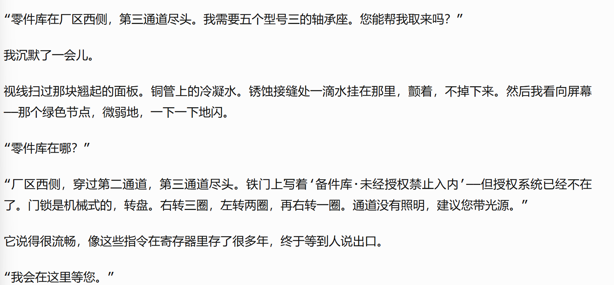
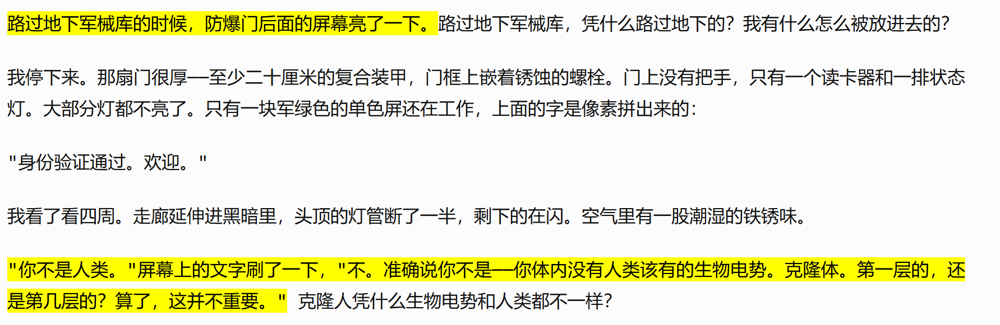
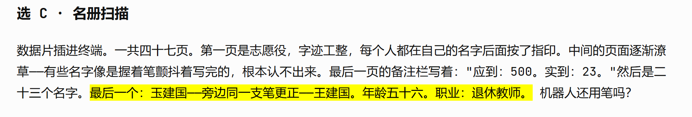

# Feedback to the stories

1. 锅炉AI TH-3 ：

这部分完全是照搬我写的哨兵，大体内容也相似，这样的故事，主角不一样，和遇到同样的哨兵也没什么区别

2. 管道检测机 PI-9

我看到了配药机的故事，后面懒得看了，完全是一样的套路，完全没有新意，还不如说做那种像你说的获得情报的内容。

或许故事不需要很多，我们可以做成每次遇到这个故事获得不一样的东西，然后这些东西对夜晚的战斗有效果。

