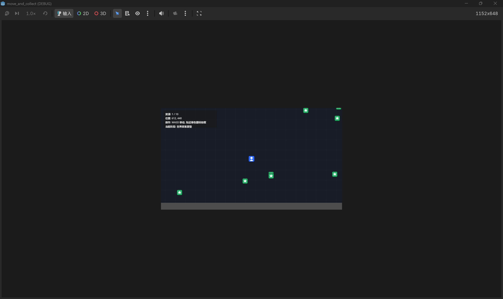

# 场景转换
现在的文档里是人和车一直在一起，这样节约燃料这一点无从实现。应该是车只在路上移动，探索时人会下车进入建筑物，步行收集资源再搬到车上。即“白天探索”这个场景需要拆开，分为2种状态：1是驾驶车辆，使用横板模式，除十字路口外，玩家都从车辆前进方向的侧面观看车辆，车本身在屏幕上保持不动，像摄像机一直跟随车辆一样，屏幕上方作为游戏世界里后方的区域通过不同速度左右移动的背景来表现行进效果，玩家按住左右方向键时汽车进行移动，在屏幕上表现为a背景的移动b缩略图里玩家位置的移动。进入十字路口时则改为使用上北下南的表示方法，和右下角缩略图保持方向一致，只需要通过汽车当前所在位置来表示我们是从哪个方向来到十字路口即可，这里玩家的上下左右方向键都有沿相应方向移动的效果，当移到某个方向的路段里一定距离后，认为选择了这一条路，再次回到非十字路口的状态。其实也可以考虑把是否位于十字路口做成2种场景；2是步行探索，应该是一个俯视图的模式，展示人物和周围环境的细节。
# 随机地图生成
这是rogue-like游戏的核心机制，地图应该直接做随机生成的，没必要先手动再生成。每次进入一个新的区域，地图都会重新生成。
# 夜晚布防
这里的逻辑没看懂。目前考虑做成类似保卫萝卜那样，每次有敌人突破防线时，资源就会被损失一部分，而不是只判断是否被攻破过。所以被攻破后也不是立即死亡。
# 地图
这里没提到，但考虑作为类似帝国时代、红色警戒那样，屏幕大部分区域是当前所在区域能看到的内容，仅为完整地图上的一个可以滑动的窗口。玩家需要通过探索来逐渐打开地图，看到更多的内容。右下角显示全局的缩略图，已探索地图为亮色，且注明资源信息，未探索地图为黑色，玩家所在位置有一个标记；在十字路口时，缩略图和主画面都统一采用上北下南的方向表达，以保证玩家能快速理解自己是从哪个方向进入路口的。这是帮助玩家对当前层进行遍历，从而保证能在有限时间内发现电梯的条件。