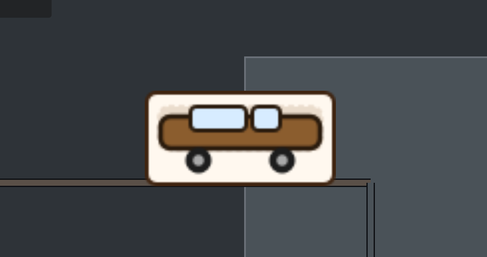
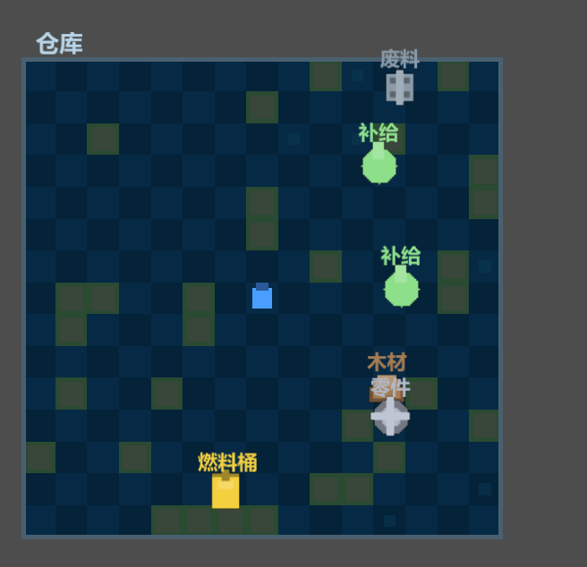
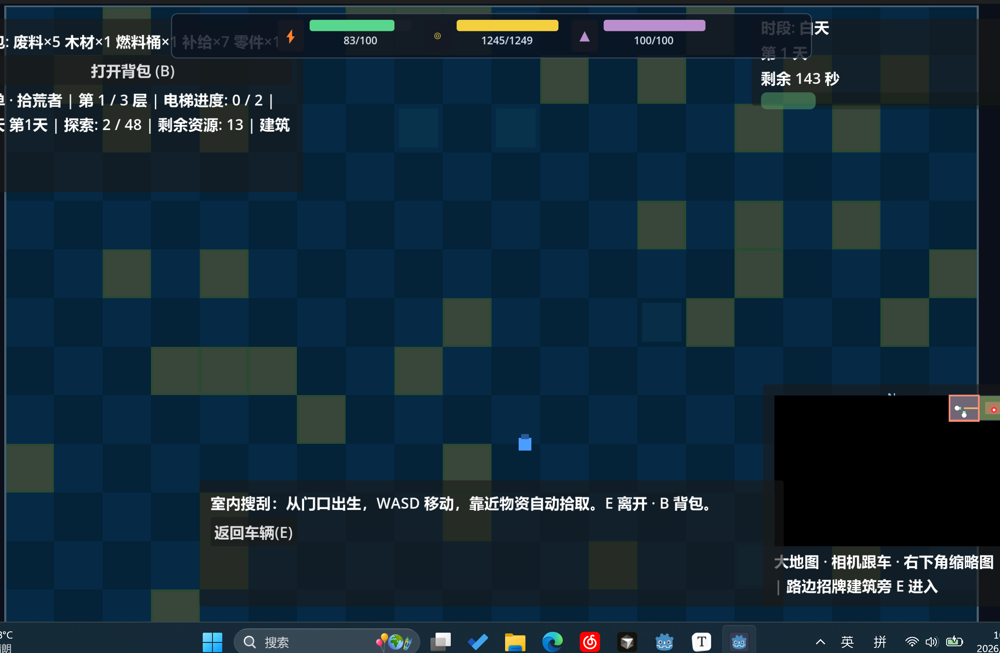

# 待修缮问题

## 已定方向（白天俯视 MVP）

- 走路网 + 像素废墟风俯视
- 车停在节点 → 列出可进建筑 → E 进入（MVP 列表方案）
- 保留右下角小地图
- 像素 16×16
- 范围：先只改白天

---

## 已处理（2026-06-01）

### 室内无法移动 / 看不见自己

- **原因**：贴边碰撞探测把“探出格子”当成障碍，门口几乎无法移动；室内相机与世界坐标错位。
- **修复**：室内改为**屏幕中央面板**绘制；WASD 在面板坐标移动；玩家在面板上有蓝色标记；**门口格（底边中线）出生**。

### 应在建筑门口探索，而非岔路口

- **修复**：仅当车辆停在 **路面格** 且邻接建筑时才显示「可进入建筑」；岔路口/普通路点不再列出相邻建筑。

### 街区占满屏 / 路网尺度

- **修复**：宏观格距 `cell_size` 调整为 **720**；室内 **20×14、24px 格**。

### 白天时长

- **修复**：`day_duration_sec = 180`（`main.tscn`）。

### 第三轮 · 大地图跟车

- 主地图**世界坐标**绘制 + **WorldCamera 跟随车辆**
- 战争迷雾 + 右下角缩略图

### 第四轮 · 路中心 / 路边小店 / 像素小车（2026-06-01）

针对反馈：车太大太丑、路太细且横向偏移、建筑看不见像在隔壁格进楼。

- **行驶**：位置改为 `cell_center` 插值，车压在**路面中心线**
- **绘制**：加宽 `draw_road_cell` / `draw_road_connector`；隐藏场景大精灵，改用 `draw_pixel_vehicle`
- **建筑**：按**路面格**遍历邻接 district，用 `draw_roadside_facade` 贴在当前路边（星露谷路边小店尺度）；选中项门口高亮
- **入口坐标**：`get_building_entrance_world_pos` 与立面门位置对齐

---

## 仍待迭代

- [ ] 门口动画 / 剧情触发器挂在建筑入口
- [ ] 真像素 TileMap 替换程序化色块
- [ ] 稀疏路网生成（减轻方格感）
- [ ] 新开局验证旧存档路网兼容性

### 第五轮 · 室内面板与门口可见（2026-06-01）

- **室内尺度**：`interior_tile_scale` 默认 **1.45**（原 2.15）
- **门口**：`get_foot_door_tile()` + `draw_interior_door`（「出口」+ 金色箭头）
- **路边立面**：再缩小；路面门垫 + 「门」字

### 路面“细线网格”修复（2026-06-01）

- **原因**：路面格只填 80% 面积 + 深色描边，格缝露出背景，看起来像黑色线框。
- **修复**：后改为星露谷式**窄土路**（见下）。

### 星露谷式窄路（2026-06-01）

- 路面格底图：**草地/废墟**（`trail`），不再铺满沥青
- 窄路宽度：约宏观格 **22%**（土色 `#a89472` + 淡黄中线）
- 岔口/枢纽：略大的节点圆 cap
