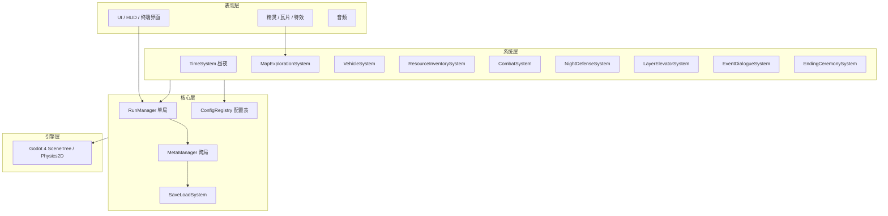
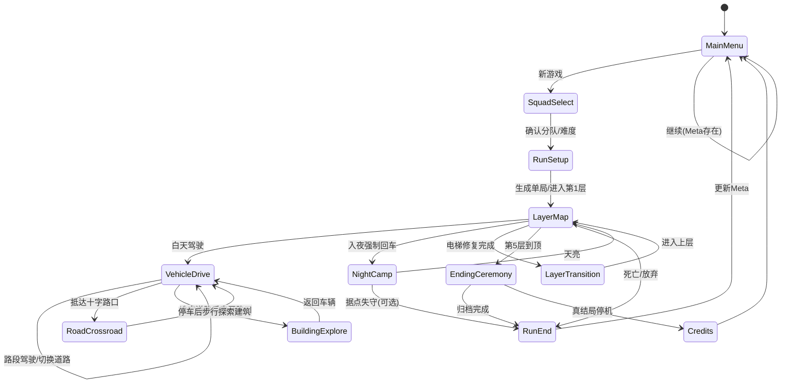
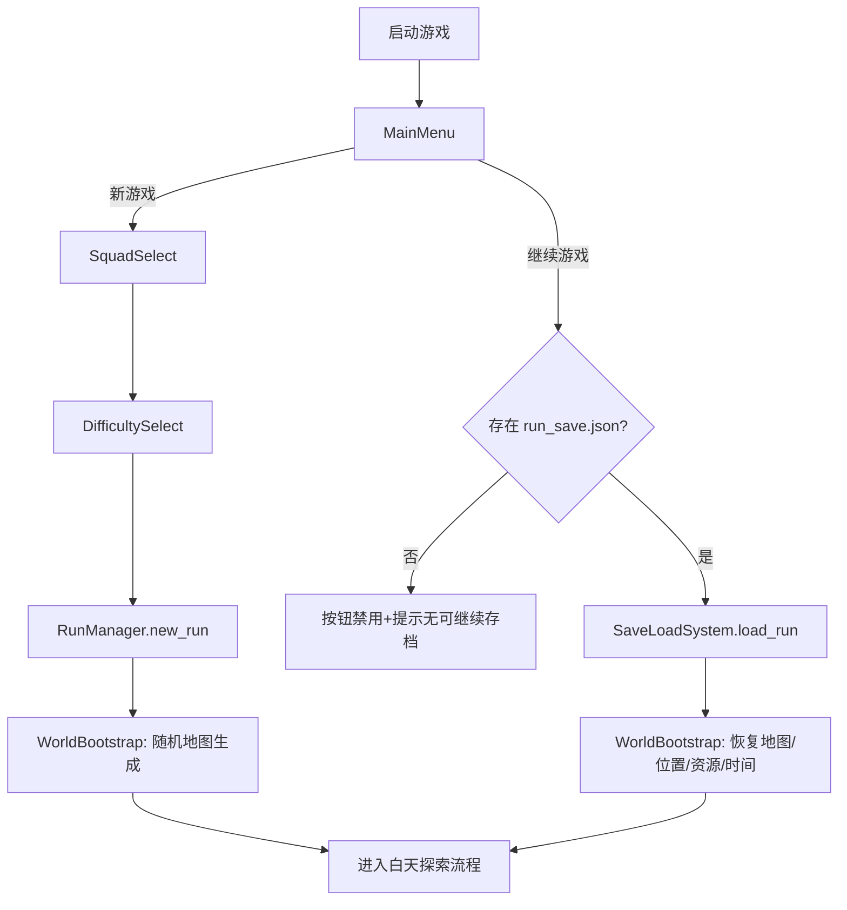

# 《终末旅行》技术设计说明书 — 草稿

> 对应课程文档：**技术设计说明书**  
> 设计输入：《游戏开发建议书》《终末旅行 — 游戏概念设计文档》  
> 文档状态：**草稿 v0.1**（可随原型迭代修订）

## 一、文档目的与范围

### 1.1 摘要

本文档将《游戏开发建议书》中的玩法与系统设计 **翻译为可实现的工程方案**，供开发阶段直接参照，包括：

- 技术选型与架构
- 模块划分与接口
- 核心数据结构与关键流程
- 存档、UI、资源管线
- 技术风险与备选方案

### 1.2 实现范围


| 阶段           | 范围                                                                    |
| ------------ | --------------------------------------------------------------------- |
| **MVP（必须）**  | 2～3 层可玩；车辆移动与燃料；基础资源与电梯修复；简化夜晚布防（1～2 种手段）；单局/跨局存档隔离；基础文本叙事；到顶归档 + 留言墙 |
| **完整版（充裕时）** | 五层完整；≥2 分队；智能机器 NPC 交涉；五层档案 Meta + 顶层三选一；层间视觉差异                       |
| **暂不实现**     | 联机、Steam 成就、Mod、完整手柄适配、多语言（可预留接口）                                     |


### 1.3 术语


| 术语        | 含义                    |
| --------- | --------------------- |
| **Run**   | 单局游戏，从克隆人投送到死亡/到顶/放弃  |
| **Meta**  | 跨局持久数据（档案、留言墙、解锁项）    |
| **Layer** | 城市层级，1～5              |
| **归档仪式**  | 到顶后的结算演出：真相片段、留言、程序播报 |


---

## 二、技术选型

### 2.1 结论


| 角色      | 选择                                     |
| ------- | -------------------------------------- |
| **主方案** | **Godot 4.x + GDScript**               |
| **备选**  | Python 3 + Arcade（若第 1 周 Spike 未通过则切换） |


**推荐 Godot 的理由**（与建议书一致）：

- 原生 2D 场景树、TileMap、碰撞、UI、状态机，覆盖本作全部底层需求
- 场景/资源编辑器减少纯代码搭建关卡的成本
- `Resource` / `JSON` 配置表适合事件池、分队、敌人数据驱动
- 轻量、无授权费，适合课程与独立项目

**Arcade 回退条件**（触发任一即评估切换）：

- 7 天内无法完成：可移动车辆 + 简单地图 + 一次昼夜切换
- TileMap/碰撞工作量超出 2 人产能且无法砍 scope

### 2.2 技术栈总表


| 类别    | 选型                                       |
| ----- | ---------------------------------------- |
| 引擎    | Godot 4.3+（LTS 稳定版优先）                    |
| 语言    | GDScript                                 |
| 版本控制  | Git + GitHub                             |
| 数据配置  | Godot Resource (`.tres`) + JSON（Meta 存档） |
| 存档    | `user://meta.json`（跨局）；单局原则上不持久化         |
| 图像    | PNG/WebP；TextureAtlas / TileSet          |
| 音频    | OGG；AudioStreamPlayer2D + BGM bus        |
| 文本    | CSV 或 JSON 外挂（中英可后加）                     |
| AI 美术 | 统一 Prompt 模板 → 人工裁剪/调色 → 导入 `assets/`    |
| 辅助开发  | Coding Agent（生成脚本草稿、工具脚本）                |


### 2.3 第三方依赖

- 尽量 **零第三方插件** 完成 MVP
- 若对话量大，可评估 **Dialogue Manager** 等 Godot 插件；MVP 阶段用自研轻量 `EventDialogueSystem` 即可

---

## 三、系统架构

### 3.1 分层架构




### 3.2 场景流转




**主场景**：


| 场景                     | 职责                                    |
| ---------------------- | ------------------------------------- |
| `main_menu.tscn`       | 新游戏、继续、设置、档案/留言墙浏览                    |
| `squad_select.tscn`    | 分队、难度                                 |
| `layer_world.tscn`     | 单层探索主场景（子节点：道路驾驶、步行探索、交互点、缩略图、路口切换）   |
| `night_camp.tscn`      | 夜晚布防 UI + 简化据点视图（或与 layer 同场景切 State） |
| `ending_ceremony.tscn` | 归档仪式、顶层三选一                            |
| `credits.tscn`         | 真结局人员名单                               |


### 3.3 单局与跨局隔离（核心原则）

```
┌─────────────────────────────────────────┐
│  MetaManager (Singleton, 持久)           │
│  - archives[1..5]: bool                 │
│  - message_wall: Array[MessageEntry]    │
│  - unlocked_squads, endings_seen        │
└─────────────────┬───────────────────────┘
                  │ 只读暴露给 Run
                  ▼
┌─────────────────────────────────────────┐
│  RunManager (每局 new / clear)           │
│  - run_state: RunState                  │
│  - 死亡/结束时 discard                   │
│  - 仅向 Meta 提交：档案片段、留言、结局标志  │
└─────────────────────────────────────────┘
```

**硬性规则**：

- `RunState` **永不**整包写入 Meta 存档
- Meta 写入只在 **RunEnd**、**EndingCeremony** 的明确 `commit()` 点发生
- 开发模式可提供「单局调试快照」，默认关闭

### 3.4 启动入口与开局分流（新增）



**入口规则**：

- 主菜单只负责路由，不承载业务状态。
- 新游戏必须经过「分队 + 难度」确认后才创建 `RunState`。
- 继续游戏只读取单局 `run_save.json`，不从 `meta.json` 反推单局状态。
- 新游戏与继续游戏最终统一进入 `WorldBootstrap`，避免双实现分叉。

### 3.5 退出机制与场景改动约束（新增）

- 每次迭代只允许新增 1～2 个场景，既有场景仅做接口级最小改动。
- 暂停菜单提供：`继续`、`保存并退出`、`放弃本局并返回主菜单`。
- 选择 `保存并退出` 时，必须先落盘 `run_save.json` 成功后再切主菜单。
- 选择 `放弃本局` 时，清除当前 `RunState` 和 `run_save.json`，但保留 `meta.json`。

---

## 四、玩法—技术映射


| 设计（建议书） | 技术实现要点                                                                   |
| ------- | ------------------------------------------------------------------------ |
| 白天探索拆分  | `VehicleDriveState` 与 `OnFootExploreState` 分离；车只在道路上移动，步行阶段进入建筑物收集资源      |
| 路口转向    | `RoadCrossroadState` 统一采用上北下南的坐标与缩略图方向；驶入指定路段一定距离后锁定路线              |
| 地图展示    | 主画面显示当前区域窗口，右下角显示全局缩略图；已探索区域高亮，未探索区域置黑，玩家位置实时标记          |
| 随机地图    | `MapGenerator` 按层种子直接生成区域图与资源点；每次进入新区域重新生成，避免先手工再导图            |
| 车载移动    | `VehicleSystem` 控制 RigidBody2D/CharacterBody2D；燃料随移动距离或时间扣减              |
| 夜晚回车停泊  | `TimeSystem` 达到 `day_length` 强制 `enter_night()`；未在安全区则惩罚                 |
| 电梯修复    | `LayerElevatorSystem` 读取 `LayerConfig.repair_cost`，消耗 `Inventory` 进度条满解锁 |
| 资源稀缺    | `ResourceInventorySystem` 堆叠上限 + 车厢容量；夜晚车外储物风险                           |
| 战斗      | `CombatSystem`：遭遇触发 → 即时或简化回合；弹药 Consumable                              |
| 夜晚布防    | `NightDefenseSystem`：每轮结算按防线被突破的程度扣除资源/耐久，不是一次性判定成败                     |
| 机器 NPC  | `EventDialogueSystem` + `NPCInstanceState` 条件表                           |
| 档案 Meta | 到达层 + `EventFlags` 触发 → `MetaManager.unlock_archive(layer)`              |
| 留言墙     | 归档时 `MessageEntry{ text, layer, timestamp, run_id }` 追加 JSON             |
| 三选一终局   | `archives.all_unlocked` && 第 5 层控制室 → `EndingCeremonySystem` 分支          |


---

## 五、模块划分

### 5.1 模块清单


| 模块                        | 类型              | 职责                   |
| ------------------------- | --------------- | -------------------- |
| `GameManager`             | Autoload        | 全局暂停、场景切换、调试命令       |
| `RunManager`              | Autoload / 或场景根 | 持有 `RunState`，局开始/结束 |
| `MetaManager`             | Autoload        | 持有 `MetaState`，读写存档  |
| `SaveLoadSystem`          | Autoload        | JSON 序列化、版本迁移        |
| `ConfigRegistry`          | Autoload        | 加载 `.tres` / JSON 配置 |
| `TimeSystem`              | Node            | 昼夜计时、阶段切换事件          |
| `MapGenerator`            | Node            | 层地图生成、区域重建、资源点/路口布局 |
| `MapExplorationSystem`    | Node            | 驾驶/步行切换、交互点、迷雾(可选)   |
| `VehicleSystem`           | Node            | 移动、燃料、车辆耐久、储物挂载      |
| `ResourceInventorySystem` | Node            | 物品增删、合成(可选)、车厢内外区分   |
| `CombatSystem`            | Node            | 遭遇、伤害、弹药             |
| `NightDefenseSystem`      | Node            | 布防布置、夜间结算            |
| `LayerElevatorSystem`     | Node            | 层索引、电梯修复、层切换         |
| `EventDialogueSystem`     | Node            | 静态事件、机器人 NPC 对话树/条件表 |
| `EndingCeremonySystem`    | Node            | 归档 UI、终局三选一          |
| `UIManager`               | CanvasLayer     | HUD、弹窗、终端风面板         |
| `AudioManager`            | Autoload        | BGM/SE _bus          |


### 5.2 建议目录结构（Godot）

```
res://
├── autoload/          # GameManager, MetaManager, SaveLoad, Audio, Config
├── scenes/
│   ├── menu/
│   ├── world/
│   ├── ui/
│   └── ceremony/
├── scripts/
│   ├── core/          # run_state.gd, meta_state.gd
│   ├── systems/       # 各 System
│   └── data/          # 配置类脚本
├── resources/         # .tres 分队、敌人、事件
├── data/json/         # meta 模板、事件表（可选）
├── assets/
│   ├── tiles/
│   ├── sprites/
│   ├── audio/
│   └── fonts/
└── tests/             # 可选：GUT 单元测试
```

### 5.3 模块依赖（简化）

- `LayerWorld` 依赖：`RunManager`, `TimeSystem`, `MapExploration`, `Vehicle`, `UI`
- `NightCamp` 依赖：`NightDefense`, `ResourceInventory`, `Vehicle`
- `EventDialogue` 依赖：`ConfigRegistry`, `RunState`（写 flags）, `MetaManager`（档案解锁）
- `EndingCeremony` 依赖：`MetaManager`, `SaveLoad`

---

## 六、核心数据结构

### 6.1 RunState（单局）

```gdscript
# 逻辑结构示意（GDScript class 或 Dictionary）
class_name RunState

var run_id: String                 # UUID
var squad_id: String
var difficulty: int
var seed: int
var current_layer: int             # 1-5
var day_index: int                 # 本层第几天

var exploration_mode: String       # "drive" | "crossroad" | "walk"
var area_seed: int                 # 当前区域随机种子
var current_area_id: String        # 当前道路/建筑区域 id
var time_phase: String             # "day" | "night"
var player_hp: float
var vehicle: VehicleState
var inventory: InventoryState
var elevator: ElevatorState        # 当前层修复进度
var event_flags: Dictionary        #  string -> bool/int
var npc_states: Dictionary         #  npc_id -> NPCInstanceState
var archives_found_this_run: Array[int]  # 本局已触发片段的层
```

### 6.2 MetaState（跨局）

```gdscript
class_name MetaState

const SAVE_VERSION := 1

var archives_unlocked: Array[bool]   # 长度 5，索引 0 = 第1层
var message_wall: Array              # MessageEntry
var endings_seen: Array[String]      # "shutdown" | "loop" | "fake_success"
var unlocked_squad_ids: Array[String]
var total_runs: int
```

### 6.3 VehicleState / InventoryState

```gdscript
class_name VehicleState
var fuel: float
var fuel_max: float
var durability: float
var position: Vector2
var facing_dir: Vector2             # 道路驾驶时的朝向
var upgrades: Dictionary           # slot -> upgrade_id

class_name InventoryState
var items: Dictionary                # item_id -> count
var cargo_inside: Dictionary         # 车内
var cargo_outside: Dictionary        # 车外（夜晚风险）
```

### 6.4 NightDefenseSetup

```gdscript
class_name NightDefenseSetup
var placed: Array[String]          # defense_id 列表，MVP 限 2 个
# 结算输入
class_name NightDefenseResult
var vehicle_damage: float
var items_lost: Dictionary
var samples_damaged: bool
```

### 6.5 配置表（Data-Driven）


| 资源类型          | 文件示例                    | 字段要点                                      |
| ------------- | ----------------------- | ----------------------------------------- |
| `SquadDef`    | `squad_scavenger.tres`  | `id`, `modifiers`                         |
| `LayerConfig` | `layer_01.tres`         | `repair_cost`, `map_pool`, `threat_table` |
| `EnemyDef`    | `drone_patrol.tres`     | `hp`, `armor`, `ai_type`                  |
| `EventDef`    | `event_terminal_a.tres` | `conditions`, `choices[]`, `effects`      |
| `DefenseDef`  | `jammer.tres`           | `counters[]`, `strength`                  |
| `ArchiveDef`  | `archive_layer_03.tres` | `layer`, `unlock_flag`, `text_id`         |


---

## 七、关键算法与流程

### 7.1 昼夜状态机

```
[DAY] --(timer >= day_length OR player_rest)--> [NIGHT_SETUP]
[NIGHT_SETUP] --(player_confirm_defense)--> [NIGHT_RESOLVE]
[NIGHT_RESOLVE] --(apply_result)--> [DAY] (+day_index)
```

- 入夜：**强制** 车辆进入 `CampZone`；否则 `%` 额外耐久损失
- `TimeSystem` 发出信号：`day_started`, `night_started`, `night_resolved`

### 7.1.1 白天到夜晚的提示与俯视布防流程（新增）

```
[DAY]
    --(timer >= warn_time)--> [RETURN_HINT]       # HUD 提示“请返回车辆准备布防”
    --(timer >= day_length && in_vehicle)--> [NIGHT_SETUP]
    --(timer >= day_length && not_in_vehicle)--> [FORCE_RETURN + penalty]

[NIGHT_SETUP]  # 同场景切状态，俯视视图，车辆为防守中心
    --(player_confirm_defense)--> [NIGHT_RESOLVE]

[NIGHT_RESOLVE]
    --(apply_result + advance_day)--> [DAY]
```

- MVP 采用「同场景切状态」实现俯视布防，减少早期场景拆分成本。
- 视图目标：风格接近 yorg.io 的俯视防守感，以车辆为中心保护对象。
- 待核心循环稳定后，再将 `NIGHT_SETUP/NIGHT_RESOLVE` 拆为独立 `night_camp.tscn`。

### 7.2 燃料消耗（推荐 MVP 方案）

```
move_cost = distance_delta * fuel_rate * squad_modifier * terrain_modifier
```

- 燃料为 0：车辆无法移动，玩家步行范围受限（可选）或只能搜附近

### 7.3 地图生成（MVP → 完整）


| 阶段  | 算法                                                            |
| --- | ------------------------------------------------------------- |
| MVP | 每层按 `LayerConfig.seed` 直接生成可走道路、十字路口、建筑点与资源点；以区域图替代手工整层图 |
| 完整  | `seed` + **房间图**：预制 `RoomChunk` 按规则拼接；保证电梯、营地、至少 1 档案点可达      |

- 地图以“当前区域窗口 + 全局缩略图”双层呈现，主画面只渲染附近可见范围
- `MapGenerator` 在进入新区域时重建当前区域内容，并同时更新缩略图探索状态
- 十字路口使用统一朝向表达，避免驾驶视角与缩略图方向混乱


### 7.4 夜晚布防结算（草案）

```
threat_power = roll_from(LayerConfig.night_threat_table)
defense_power = sum(DefenseDef.strength against threat_tags)

if defense_power >= threat_power:
    result = minimal_loss
elif defense_power >= threshold_partial:
    result = outside_cargo_loss_sample() + minor_vehicle_damage
else:
    result = outside_cargo_loss_major() + vehicle_damage
```

- **环境恶化（B）**：与 `defense_power` 无关的固定 `environment_tick_damage`，被 `shelter_upgrade` 减免
- **自动回收（A）**：由 `defense_power` 与 `cargo_outside` 共同决定损失
- **失败不等于死亡**：夜晚被突破时先损资源、耐久和外置货物，只有连续崩溃或关键值归零时才结束本局

### 7.5 档案解锁

```gdscript
func try_unlock_archive(layer: int, flag: String) -> void:
    if not ConfigRegistry.archive_requires(layer, flag):
        return
    if RunManager.run_state.event_flags.get(flag, false):
        MetaManager.unlock_archive(layer)  # 持久化
```

- **不必到第 5 层**：只要本局到达该层并满足 `ArchiveDef` 条件即 `commit` 到 Meta

### 7.6 顶层终局

```gdscript
func can_show_final_choice() -> bool:
    return MetaManager.all_archives_unlocked() \
        and RunManager.run_state.current_layer == 5

func apply_ending(choice: String) -> void:
    match choice:
        "shutdown": MetaManager.endings_seen.append("shutdown"); ...
        "loop": append_message_only(); ...
        "fake_success": MetaManager.endings_seen.append("fake_success"); ...
    SaveLoadSystem.save_meta()
```

---

## 八、持久化与存档

### 8.1 文件


| 文件                          | 内容             |
| --------------------------- | -------------- |
| `user://meta.json`          | `MetaState` 全量 |
| `user://run_save.json`      | 当前可继续单局快照（RunState 子集） |
| `user://settings.cfg`       | 音量、键位、窗口       |
| （可选）`user://debug_run.json` | 开发用单局快照        |

### 8.1.1 存档策略（自动 + 手动）

- 自动存档触发点（白天关键节点）：
    - 进入新区块
    - 资源结算后
    - 日夜切换结算完成后
- 手动存档触发点：暂停菜单 `保存并退出`。
- 写盘流程：先写 `run_save.tmp`，成功后原子替换 `run_save.json`。
- 读取失败处理：尝试 `run_save.bak`；若仍失败，提示损坏并禁用继续按钮。

### 8.1.2 Run 快照字段约束（新增）

- `run_save.json` 只保存继续游戏所需字段：
    - `run_id`, `squad_id`, `difficulty`, `seed`, `current_layer`, `day_index`
    - `time_phase`, `exploration_mode`, `current_area_id`, `area_seed`
    - `player_hp`, `vehicle`, `inventory`, `elevator`
    - `event_flags`, `npc_states`, `archives_found_this_run`
- 禁止写入跨局字段（如 `archives_unlocked`, `message_wall`, `endings_seen`）。


### 8.2 JSON 示例（片段）

```json
{
  "save_version": 1,
  "archives_unlocked": [true, true, false, false, false],
  "message_wall": [
    { "text": "不要信终端上的重建倒计时。", "layer": 3, "run_id": "a1b2" }
  ],
  "endings_seen": [],
  "unlocked_squad_ids": ["scavenger", "logistics"],
  "total_runs": 7
}
```

### 8.3 版本迁移

- `save_version` 不匹配时：尝试字段级迁移；失败则备份旧文件并新建 Meta（开发期可接受；发布前需完善）

---

## 九、用户界面与输入

### 9.1 UI 分层


| 层级       | 内容                   |
| -------- | -------------------- |
| HUD      | 燃料、生命、时间（昼/夜）、层数、快捷栏、当前探索模式 |
| MiniMap  | 右下角全局缩略图：已探索高亮、未探索黑块、玩家位置标记、路口方向提示 |
| Terminal | 昆仑风面板：背包、车辆、电梯修复、档案  |
| Overlay  | 对话、事件选项、布防放置         |
| Modal    | 暂停、确认、归档、三选一         |


### 9.2 默认键位（草案）


| 操作     | 键位         |
| ------ | ---------- |
| 移动     | WASD / 方向键 |
| 交互     | E          |
| 开火     | 鼠标左键 / J   |
| 背包     | Tab        |
| 入夜确认布防 | Space      |
| 暂停     | Esc        |


### 9.3 对话 UI

- MVP：`EventDialogueSystem` 显示 **说话者 ID + 文本 + 2～4 选项按钮**
- 机器 NPC：说话者显示为 `档案管理机 #07` 等，头像复用同一套机器人 Silhouette

---

## 十、资源管线与性能

### 10.1 美术

- 地块：16×16 或 32×32 统一网格；`TileSet` 碰撞层分离（地形 / 障碍 / 交互）
- 模块化废墟：`RuinModule_A`… 在编辑器中拼贴，避免每层从零画大地图

### 10.2 音频

- BGM：菜单 1、探索 1、夜晚 1；用 `AudioManager` 交叉淡化
- SE：UI、引擎、开火、机器人语音哔声（可合成短样本）

### 10.3 文本

- `data/localization/zh_CN.json`：`key -> string`
- 事件与档案仅存 `text_id`，便于校对与 Agent 辅助生成

### 10.4 性能目标


| 指标   | 目标                                          |
| ---- | ------------------------------------------- |
| 帧率   | 60 FPS @ 1080p（集显可 30 FPS 降级）               |
| 同屏敌人 | MVP ≤ 15 活跃单位                               |
| 加载   | 层切换 < 2s（异步 `ResourceLoader.load_threaded`） |

### 10.5 Dummy 素材先行规范（新增）

- 在缺少正式素材时，优先使用 dummy 素材保证功能不中断。
- 存放目录：`res://assets/dummy/`（按 `ui/`, `icons/`, `units/` 子目录组织）。
- 建议规格：PNG、透明背景、64/128 等偶数尺寸。
- 首批最小素材集：
    - 主菜单按钮占位（新游戏/继续/设置/退出）
    - 分队头像占位（至少 2 个）
    - 难度图标占位（至少 3 档）
    - 夜晚布防图标（防御槽位、威胁类型、车辆受损提示）
- 若后续引入 AI 批量出图，需保留同名资源路径，避免代码与场景引用变更。


---

## 十一、开发流程与协作

### 11.1 迭代顺序（与建议书 28 天对齐）


| 周次    | 技术交付物                                                               |
| ----- | ------------------------------------------------------------------- |
| 第 1 周 | Godot 项目骨架；`RunManager`/`MetaManager`/`SaveLoad`；车辆移动；单层灰盒地图；昼夜切换占位 |
| 第 2 周 | 资源与燃料；电梯修复；2～3 层；`NightDefenseSystem` MVP                           |
| 第 3 周 | 归档仪式 + 留言 JSON；`EventDialogue` 最小实现；档案解锁；终端 UI 皮肤                   |
| 第 4 周 | 整合测试；音频接入；顶层三选一；性能与存档迁移；Windows 导出                                  |


### 11.2 技术 Spikes（第 1 周必须完成）

- Godot 导出 Windows 可执行文件
- `meta.json` 读写与 Run 隔离验证
- TileMap 碰撞 + 车辆 `CharacterBody2D` 移动
- 一次完整「白天→夜晚→结算→白天」

### 11.3 测试策略


| 类型       | 对象                                                       |
| -------- | -------------------------------------------------------- |
| 单元       | `NightDefenseResolver`, `ArchiveUnlock`, `SaveMigration` |
| 集成       | 从 `SquadSelect` 到 `RunEnd` 无人为干预脚本                       |
| Playtest | 燃料压力、能否在 3 天内修电梯（记录局时长）                                  |


### 11.4 构建发布

```bash
# Godot 编辑器：项目 → 导出 → Windows Desktop
# 输出：build/EndJourney_windows.exe + pck
```

- 提交作业：exe + 简短「操作说明.txt」+ 已知问题列表

### 11.5 Copilot 分阶段实施计划（新增）

| 阶段 | 目标 | 场景变化 | 核心产出 | 验收标准 |
| --- | --- | --- | --- | --- |
| Phase 0 | 基线与约束固化 | 无新场景 | DoD 与任务模板、输入映射整理 | 文档可直接用于任务拆分 |
| Phase 1 | 主入口流程 | 新增 `main_menu.tscn` | 新游戏/继续/设置占位/退出 | 继续按钮在无档时禁用 |
| Phase 2 | 新游戏初始化 | 新增 `squad_select.tscn`（可含难度） | 分队+难度确认并创建 `RunState` | 可稳定进入白天探索 |
| Phase 3 | 继续游戏恢复 | 不新增或仅补桥接场景 | `run_save.json` 读取与状态恢复 | 关闭重开后能从上次状态继续 |
| Phase 4 | 存档机制落地 | 新增 `pause_menu.tscn`（或 UI 层） | 自动关键点存档 + 保存并退出 | 退出前成功落盘且可继续 |
| Phase 5 | 白天状态机标准化 | 复用 `layer_world.tscn` | `drive/junction/foot` 统一状态切换 | 无卡死、无重复切换 Bug |
| Phase 6 | 夜晚布防 MVP | 同场景切 `night_setup/night_resolve` | 俯视布防+结算三档结果 | 可完成“白天->夜晚->白天”循环 |
| Phase 7 | 逐场景扩展 | 依次新增 `layer_transition` / `event_dialogue` / `ending_ceremony` / `credits` | 完整主循环 + 终局链路 | 每新增场景后全流程回归通过 |
| Phase 8 | 夜晚场景重构（可选） | 新增 `night_camp.tscn` | 将夜晚从同场景状态拆为独立场景 | 数据接口不变，表现层替换成功 |

**实施原则**：

- 每阶段结束必须可运行、可进入、可退出、可存档恢复。
- 每阶段仅引入一个主风险点，避免多系统并行联调。
- 若某阶段未达验收标准，禁止推进下一阶段。

### 11.6 每阶段任务卡模板（新增）

```
任务名：
目标：
输入（依赖）：
输出（新增文件/改动文件）：
实现步骤（1..N）：
验收清单：
回滚方案：
```

---

## 十二、技术风险与备选方案


| 风险          | 影响        | 缓解措施                                                | 备选                   |
| ----------- | --------- | --------------------------------------------------- | -------------------- |
| Meta/Run 混淆 | 存档损坏、进度丢失 | 单写入口 `MetaManager.commit()`；Code Review 禁止 Run 整包入库 | 开发期备份 `meta.bak`     |
| 布防数值失衡      | 无策略或必败    | MVP 仅 2 种威胁 × 2 种布防；表格驱动快速调参                        | 加入「强制低风险夜」难度选项       |
| 对话状态爆炸      | 维护困难      | `event_flags` 字典 + 条件表达式字符串；限制 MVP 事件数 ≤ 15         | 砍掉多轮 NPC，仅保留终端事件     |
| 五层美术产能      | 视觉疲劳      | 模块化地块 + 色调 shader 参数 `layer_tint`                   | MVP 仅 3 层外观差异        |
| 系统耦合        | 后期集成 Bug  | **核心循环优先**；每加系统跑一次完整 Run                            | 功能开关 `FeatureFlags`  |
| Godot 学习曲线  | 第 1 周延期   | 第 1 天官方 2D 教程；Spike 不通过即转 Arcade                    | Python + Arcade 重搭骨架 |
| 性能          | 低配卡顿      | 对象池；敌人离屏暂停 AI                                       | 降低分辨率缩放              |


**网络**：本作无联机，无需考虑服务器、同步与反作弊。

---

## 十三、附录

### A. MVP 功能—模块检查表


| 功能        | 模块                           | MVP          |
| --------- | ---------------------------- | ------------ |
| 车辆移动      | VehicleSystem                | ✅            |
| 燃料        | VehicleSystem                | ✅            |
| 昼夜        | TimeSystem                   | ✅            |
| 夜晚布防      | NightDefenseSystem           | ✅ 简化         |
| 电梯修复      | LayerElevatorSystem          | ✅            |
| 2～3 层     | MapExploration + LayerConfig | ✅            |
| Meta 存档   | SaveLoad + MetaManager       | ✅            |
| 留言墙       | EndingCeremony + Meta        | ✅            |
| 档案片段      | EventDialogue + Meta         | ✅ 可先 2 层     |
| 机器 NPC 对话 | EventDialogue                | ⏳ 充裕时        |
| 五层 + 三选一  | Layer + EndingCeremony       | ⏳ 充裕时        |
| 战斗        | CombatSystem                 | ✅ 简化 1～2 种敌人 |


### B. 待 GDD 补齐后回溯项

- 精确数值：燃料率、修复成本、伤害公式
- 每层地图尺寸与敌人密度
- 分队完整列表与 modifier 公式
- 智能 NPC 数量与对话图

### C. 文档修订记录


| 版本      | 日期         | 说明                 |
| ------- | ---------- | ------------------ |
| 草稿 v0.1 | 2026-05-19 | 初稿：架构、模块、数据结构、流程草案 |
| 草稿 v0.2 | 2026-05-20 | 新增启动入口、存档策略、昼夜提示与俯视布防流程、分阶段实施计划 |


---

## 相关文档

- [终末旅行 — 技术设计说明书（大纲）](./终末旅行%20—%20技术设计说明书（大纲）.md)
- [游戏开发建议书](./游戏开发建议书.md)
- [终末旅行 — 游戏概念设计文档](./终末旅行%20—%20游戏概念设计文档.md)
- [游戏文档要求](./游戏文档要求.md)

